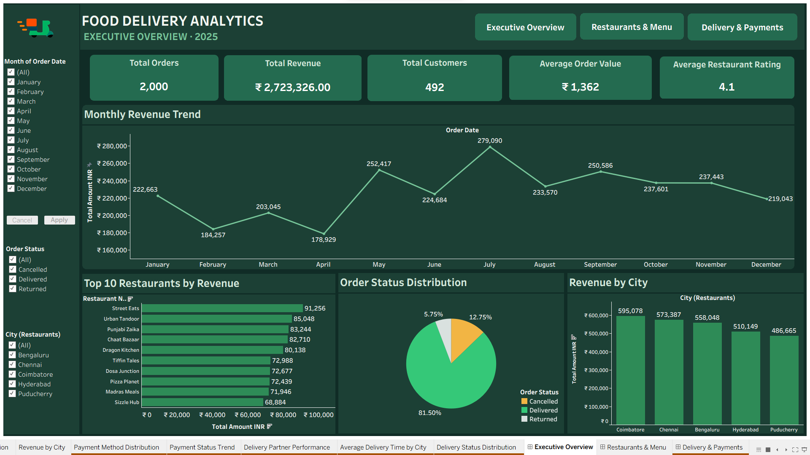
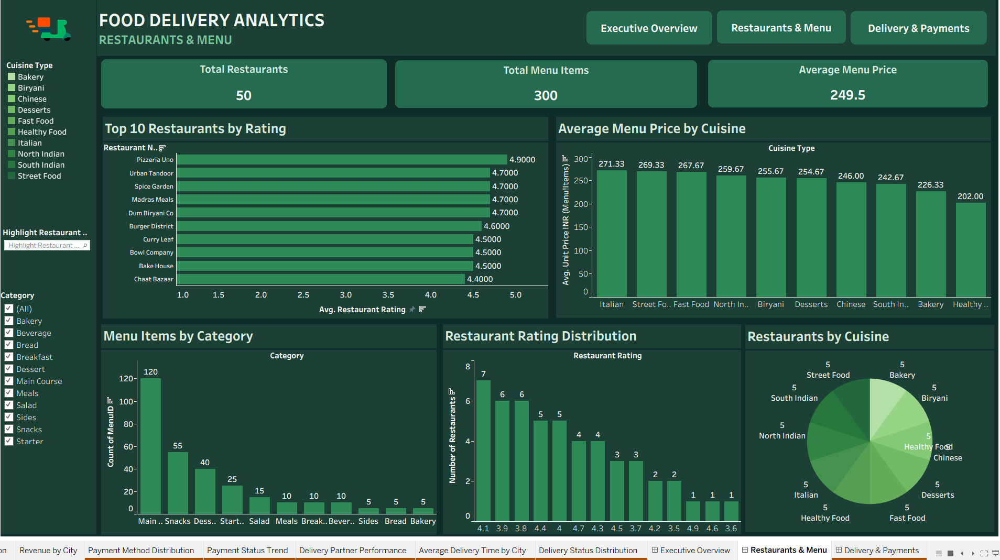
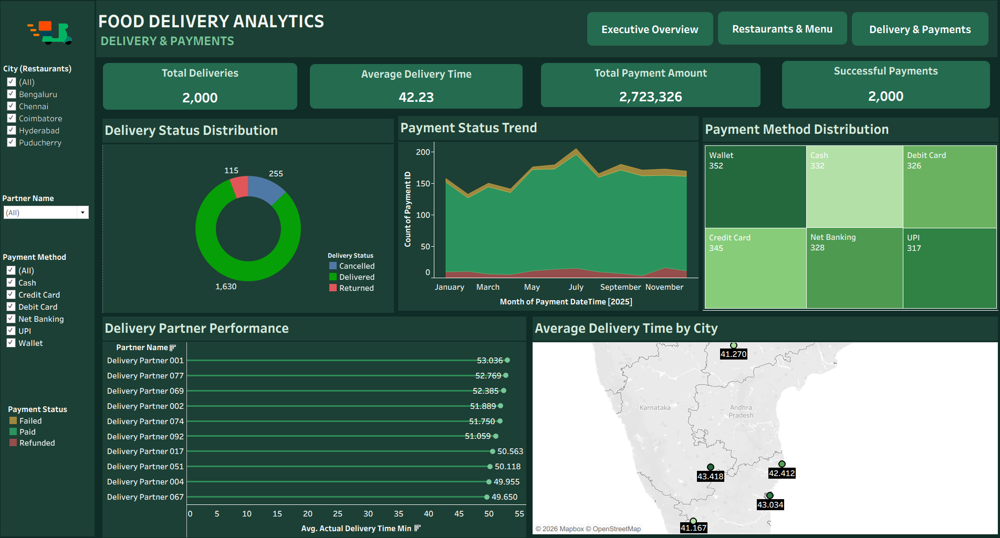

# Food Delivery Analytics

### Interactive Tableau Dashboard | Data Analytics Portfolio Project

## Dashboard Video Demo

Watch the complete screen recording of all three Food Delivery Analytics dashboards.

[Click here to watch the Tableau dashboard screen recording](https://drive.google.com/file/d/1jnVnGenVMz6RGJ38SrPSHimgGsa8Fu1e/view?usp=sharing)

## Dashboard Preview

### 1. Executive Overview



### 2. Restaurants & Menu



### 3. Delivery & Payments



---

## Project Overview

Food Delivery Analytics is an interactive data analytics project developed using Tableau Desktop to analyze food delivery operations, restaurant performance, menu items, customer orders, delivery efficiency, and payment trends.

The project uses a structured Excel dataset containing multiple related tables. Tableau relationships connect the tables to create interactive dashboards with KPI cards, charts, maps, and visualizations.

The project consists of three dashboards:

1. Executive Overview
2. Restaurants & Menu
3. Delivery & Payments

The main objective is to transform raw data into meaningful business insights, identify trends, evaluate operational performance, and support data-driven decision-making.

## Tools and Technologies

| Tool | Purpose |
|---|---|
| Tableau Desktop | Dashboard development and data visualization |
| Microsoft Excel | Dataset storage and data inspection |
| Tableau Relationships | Connecting multiple data tables |
| GitHub | Project documentation and version control |

## Dataset Description

The project uses an Excel workbook containing 11 sheets with related food delivery information.

| Sheet Name | Description |
|---|---|
| Orders | Order details, dates, customers, restaurants, and amounts |
| Customers | Customer information |
| Restaurants | Restaurant details, locations, and ratings |
| Calendar | Date information |
| Order_Items | Individual items included in orders |
| Menu_Items | Menu item names, categories, and prices |
| Deliveries | Delivery details and delivery status |
| Delivery_Partners | Delivery partner information |
| Payments | Payment methods, amounts, and statuses |
| Relationships_Guide | Reference for connecting tables |
| Data_Dictionary | Description of dataset fields |

## Dashboard 1: Executive Overview

Provides a consolidated view of overall food delivery business performance.

### Key Performance Indicators

- Total Orders
- Total Revenue
- Total Customers
- Average Order Value
- Average Restaurant Rating

### Charts and Visualizations

- Monthly Revenue Trend
- Top 10 Restaurants by Revenue
- Order Status Distribution
- Revenue by City
- Revenue by Cuisine

### Dashboard Screenshot


### Business Insights

- Monitor overall order and revenue performance.
- Identify monthly revenue trends.
- Compare restaurant revenue contributions.
- Understand revenue distribution across cities and cuisines.
- Evaluate overall restaurant ratings.

## Dashboard 2: Restaurants & Menu

Focuses on restaurant performance, cuisine categories, menu items, and pricing.

### Key Performance Indicators

- Total Restaurants
- Total Menu Items
- Average Menu Price

### Charts and Visualizations

- Top 10 Restaurants by Rating
- Restaurants by Cuisine
- Menu Items by Category
- Average Menu Price by Cuisine
- Restaurant Rating Distribution

### Dashboard Screenshot


### Business Insights

- Identify highly rated restaurants.
- Understand restaurant distribution across cuisines.
- Analyze menu item categories.
- Compare average menu prices across cuisines.
- Understand restaurant rating distribution.

## Dashboard 3: Delivery & Payments

Analyzes delivery operations, delivery partner performance, and payment activity.

### Key Performance Indicators

- Total Deliveries
- Average Delivery Time
- Total Payment Amount
- Successful Payments

### Charts and Visualizations

- Delivery Status Distribution
- Average Delivery Time by City
- Delivery Partner Performance
- Payment Method Distribution
- Monthly Payment Status Trend

### Dashboard Screenshot


### Business Insights

- Understand delivery status distribution.
- Compare average delivery times across cities.
- Evaluate delivery partner performance.
- Analyze customer payment method preferences.
- Monitor successful, failed, and pending payment trends.

## Data Relationships

The following relationships were established in Tableau:

| Tables | Relationship Field |
|---|---|
| Orders and Customers | Customer_ID |
| Orders and Restaurants | Restaurant_ID |
| Orders and Calendar | Order_Date and Date |
| Orders and Order_Items | Order_ID |
| Order_Items and Menu_Items | Menu_Item_ID |
| Orders and Deliveries | Order_ID |
| Deliveries and Delivery_Partners | Delivery_Partner_ID |
| Orders and Payments | Order_ID |

These relationships allow analysis across different areas of the food delivery business.

## Key Business Questions

- How many orders and customers are recorded?
- How does revenue change month by month?
- Which restaurants generate the highest revenue?
- Which cities and cuisines contribute to revenue?
- Which restaurants have the highest ratings?
- How are restaurants distributed across cuisine categories?
- Which menu categories contain the most items?
- Which cuisines have higher average menu prices?
- What is the distribution of delivery statuses?
- Which cities have higher average delivery times?
- How does delivery partner performance compare?
- Which payment methods are most commonly used?
- How do payment statuses change over time?

## Key Performance Indicators

| KPI | Description |
|---|---|
| Total Orders | Distinct count of order IDs |
| Total Revenue | Sum of order amounts |
| Total Customers | Distinct count of customer IDs |
| Average Order Value | Average order amount |
| Average Restaurant Rating | Average restaurant rating |
| Total Restaurants | Distinct count of restaurant IDs |
| Total Menu Items | Distinct count of menu item IDs |
| Average Menu Price | Average menu item price |
| Total Deliveries | Distinct count of delivery IDs |
| Average Delivery Time | Average delivery time in minutes |
| Total Payment Amount | Sum of payment amounts |
| Successful Payments | Count of successful payment transactions |

## Repository Structure

```text
Food-Delivery-Analysis/
│
├── README.md
│
├── screenshots/
│   ├── Executive_Overview.png
│   ├── Restaurants_Menu.png
│   ├── Delivery_Payments.png
│   ├── Delivery Partner Performance.png
│   ├── Menu Items by Category.png
│   ├── Monthly Revenue Trend.png
│   ├── Payment Status Trend.png
│   └── Other chart screenshots
│
├── workbooks/
│   ├── Tableau Workbook
│   └── Food_Delivery_Analytics.xlsx
│
└── data/
```

## How to Explore the Project

1. Clone or download this GitHub repository.
2. Open the `workbooks` folder.
3. Open the Tableau workbook using Tableau Desktop.
4. Explore all three dashboard pages.
5. Interact with the available charts and filters.
6. Review restaurant performance, menu analysis, delivery operations, and payment trends.
7. Refer to the Excel dataset to understand the source tables.
8. Watch the complete dashboard walkthrough using the video link provided above.

## Skills Demonstrated

- Tableau Desktop
- Dashboard Development
- Data Visualization
- Microsoft Excel
- Data Relationships
- KPI Design
- Business Analytics
- Revenue Analysis
- Restaurant Performance Analysis
- Delivery Operations Analysis
- Payment Analysis
- Interactive Dashboard Design
- Data Storytelling

## Project Conclusion

This project demonstrates the use of Tableau and Excel to analyze food delivery business operations through interactive dashboards.

It provides insights into revenue performance, restaurant ratings, menu pricing, delivery efficiency, delivery partner performance, and payment trends.

The project helped develop practical skills in data analysis, data visualization, dashboard development, and business intelligence.

## Disclaimer

This project is created for educational, practice, and portfolio purposes. The dataset is intended for analytical demonstration and does not represent official operational or financial information from any specific food delivery company.

---

*Created as a Data Analytics portfolio project using Tableau Desktop and Microsoft Excel.*