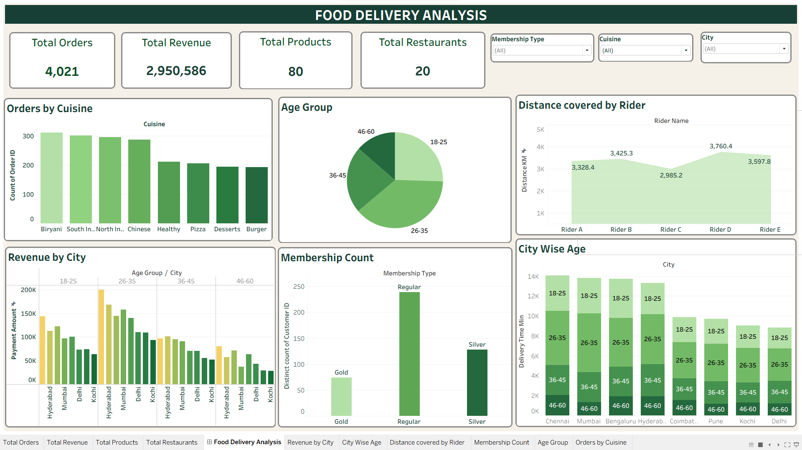

# Food Delivery Analytics

### Interactive Tableau Dashboard | Data Analytics Portfolio Project

## Dashboard Video Demo

Watch the complete walkthrough of the Food Delivery Analysis Tableau dashboard.

[Click here to watch the dashboard video](https://drive.google.com/file/d/18MtUkEj1cTj0RBFUeJ3f15xesbqVqf2W/view?usp=sharing)

## Dashboard Preview

### Executive Overview



## Project Overview

Food Delivery Analytics is an interactive data analytics project developed using Tableau to analyze food delivery orders, customer demographics, cuisine preferences, restaurant performance, membership patterns, revenue distribution, and rider operations.

The project uses an Excel dataset to explore business performance through interactive dashboards, KPI cards, charts, and data visualizations.

The goal is to transform raw data into meaningful business insights, identify patterns in customer behavior, compare city-wise performance, and support data-driven decision-making.

This project is part of my Data Analytics portfolio and demonstrates practical skills in Tableau, Excel, data visualization, and business analytics.

> **Disclaimer:** This project is intended for educational, practice, and portfolio purposes. The dataset and analysis should not be interpreted as official data from any specific food delivery company.

## Business Objectives

- Analyze overall food delivery performance.
- Understand customer age groups and demographics.
- Compare customer distribution across cities.
- Analyze membership distribution and customer preferences.
- Identify popular cuisines based on order volume.
- Compare revenue performance across cities.
- Analyze rider distance and delivery operations.
- Identify patterns in food ordering behavior.
- Build interactive dashboards for business reporting.
- Present business insights through meaningful visualizations.

## Tools and Technologies

| Tool | Purpose |
|---|---|
| Tableau Desktop | Dashboard creation and data visualization |
| Microsoft Excel | Dataset storage and data inspection |
| Tableau Public | Publishing and sharing interactive dashboards |
| GitHub | Project documentation and version control |

## Dataset Description

The project uses `Food_Delivery_Analytics.xlsx`, an Excel workbook containing the data used to build the Food Delivery Analytics dashboard.

The dataset supports analysis of customer demographics, cuisine preferences, membership distribution, city-wise revenue, and rider distance.

| Analysis Area | Description |
|---|---|
| Customer Demographics | Customer age groups and demographic patterns |
| City Analysis | Customer distribution across different cities |
| Membership Analysis | Distribution of customers by membership category |
| Cuisine Analysis | Order distribution across different cuisines |
| Revenue Analysis | Revenue comparison across cities |
| Rider Analysis | Distance covered by riders |
| Dashboard Summary | Consolidated view of key business metrics |

The exact dataset fields, record counts, and calculations should be verified against the Excel workbook before documenting specific figures.

## Dashboard Pages

The following dashboard views are included in the project.

### 1. Executive Overview

Provides a consolidated view of the food delivery dataset through an interactive Tableau dashboard.

The overview helps users understand the major business metrics and explore patterns across customer demographics, cuisine preferences, revenue, membership, and rider operations.

### 2. Age Group Analysis

Analyzes customer distribution across different age groups.

The analysis helps identify:

- Customer count by age group.
- Distribution of customers across demographic categories.
- Age-group patterns in the customer base.
- Differences in customer distribution.

### 3. City-wise Age Analysis

Explores customer age distribution across different cities.

The analysis includes:

- Customer count by city.
- Age-group distribution across cities.
- Comparison of customer demographics.
- City-wise customer patterns.

### 4. Membership Analysis

Examines the distribution of customers across membership categories.

The dashboard explores:

- Membership count.
- Distribution by membership type.
- Comparison of membership categories.
- Customer membership patterns.

### 5. Cuisine Analysis

Analyzes food ordering preferences across different cuisine categories.

The dashboard focuses on:

- Orders by cuisine.
- Popular cuisine categories.
- Comparison of order volumes.
- Customer food preferences.

### 6. Revenue by City

Compares revenue performance across different cities.

The analysis includes:

- Revenue generated by city.
- Comparison of city-wise revenue.
- High-performing cities.
- Revenue distribution across locations.

### 7. Rider Distance Analysis

Explores the distance covered by riders as part of food delivery operations.

The analysis focuses on:

- Distance covered by riders.
- Comparison of rider distances.
- Distribution of delivery distances.
- Operational patterns in delivery activity.

## Key Performance Indicators

The following KPIs can be used where the required fields are available in the dataset:

- **Total Customers:** Distinct count of customer IDs.
- **Total Orders:** Count of unique order IDs.
- **Total Revenue:** Sum of the relevant revenue field.
- **Total Cities:** Distinct count of cities.
- **Total Memberships:** Count of customers belonging to membership categories.
- **Most Popular Cuisine:** Cuisine with the highest order count.
- **Top Revenue City:** City generating the highest revenue.
- **Average Rider Distance:** Average distance covered by riders.

KPI definitions should be verified against the actual Excel data and Tableau calculations.

## Key Business Insights

The dashboard can be used to investigate important business questions, including:

- Which age group represents the largest customer segment?
- Which cities have the highest customer counts?
- Which membership category has the most customers?
- Which cuisine receives the highest number of orders?
- Which cities generate the highest revenue?
- How does revenue vary across cities?
- What patterns can be observed in rider distances?
- Which customer segments could be explored for targeted marketing?

Add three to five verified findings using actual dashboard values. Explain briefly how each finding could help a business improve customer engagement, marketing, revenue generation, or delivery operations.

## Dashboard Screenshots

### Executive Overview


### Age Group Analysis


### City-wise Age Analysis


### Membership Analysis


### Cuisine Analysis


### Revenue by City


### Rider Distance Analysis


## Live Interactive Dashboard

The Tableau Public link can be added here after publishing the workbook.

**Tableau Public:** [View Interactive Dashboard](#)

## Repository Structure

```text
Food-Delivery-Analysis-/
│
├── README.md
│
├── screenshots/
│   ├── Age Group.png
│   ├── City wise Age Count.png
│   ├── Dashboard.png
│   ├── Distance covered by Rider.png
│   ├── Membership Count.png
│   ├── Orders by Cuisine.png
│   ├── Revenue by City.png
│   └── Screen Recording 2026-10-23 174006.mp4
│
├── workbooks/
│   ├── Food Order Analysis.twb
│   └── Food_Delivery_Analytics.xlsx
│
└── data/
```

## Data Relationships

The project uses the Excel dataset as the source for Tableau visualizations.

If the workbook contains multiple related tables, establish relationships using the appropriate common identifiers, such as customer ID, order ID, restaurant ID, or city ID, where available.

Verify the actual worksheet names and column names in `Food_Delivery_Analytics.xlsx` before documenting specific relationships.

## How to Explore the Project

1. Clone or download the GitHub repository.
2. Open the `workbooks` folder.
3. Open `Food Order Analysis.twb` using Tableau Desktop.
4. Reconnect the Excel data source if necessary.
5. Verify the data source and calculated fields.
6. Explore the individual worksheets.
7. Open the dashboard and interact with available filters.
8. Review age groups, city-wise customer counts, membership, cuisine, revenue, and rider distance.
9. Watch the dashboard walkthrough using the video link in this README.
10. Visit the Tableau Public link once the dashboard has been published.

## Skills Demonstrated

- Data Visualization
- Tableau Dashboard Development
- Microsoft Excel
- Exploratory Data Analysis
- KPI Design
- Business Analytics
- Customer Demographic Analysis
- City-wise Analysis
- Membership Analysis
- Cuisine and Order Analysis
- Revenue Analysis
- Delivery Operations Analysis
- Interactive Dashboard Design
- Data Storytelling
- Business Problem-Solving

## About the Project

This project is part of my Data Analytics portfolio and demonstrates my ability to analyze structured datasets, develop interactive Tableau dashboards, compare business metrics, and communicate findings through data visualization.

The project showcases practical application of Tableau and Excel to explore customer behavior, cuisine preferences, city-wise revenue, membership patterns, and rider operations.

## Disclaimer

This project is created for educational, practice, and portfolio purposes. The dataset is intended for analytical demonstration and should not be considered official operational or financial information from any specific food delivery company.

---

*Created as a Data Analytics portfolio project using Tableau and Excel.*
